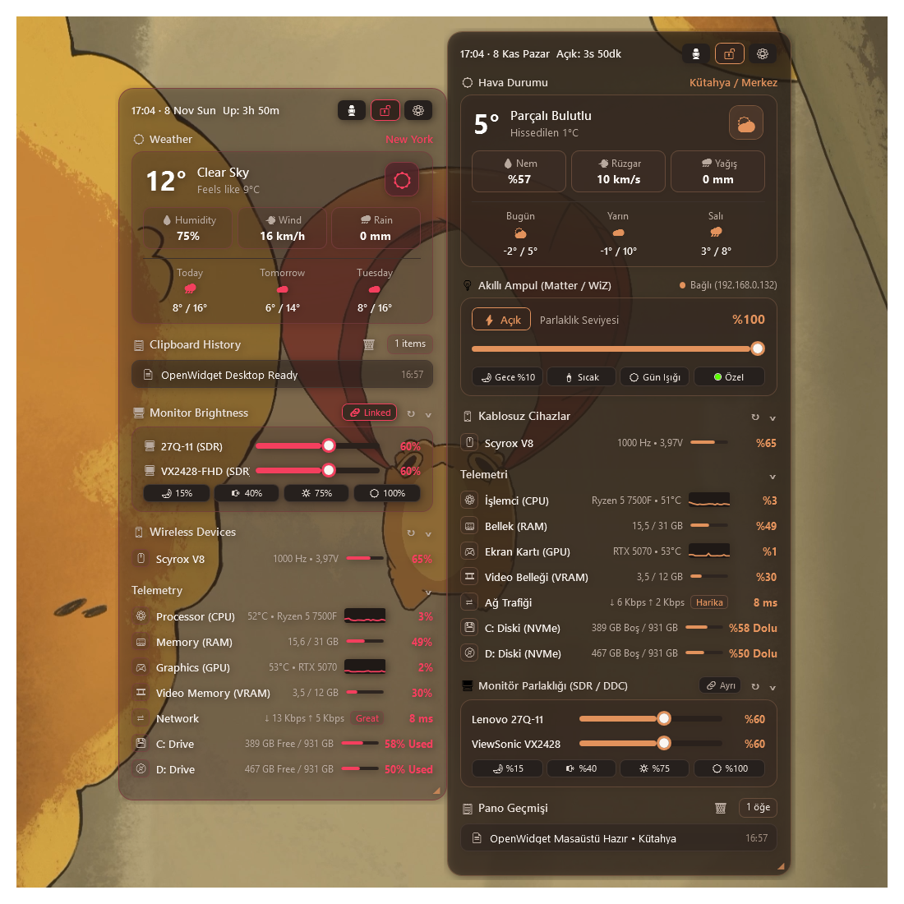

# OpenWidget for Windows (`openwidget-windows`)

> **Ultra-Lightweight, Native Frosted-Glass Desktop Widget for Windows 10 & 11**

[-0078D6?style=for-the-badge&logo=windows)](https://github.com/safeapricot/openwidget-windows)
[](https://github.com/safeapricot/openwidget-windows)
[](https://github.com/safeapricot/openwidget-windows)
[](https://github.com/safeapricot/openwidget-windows)
[](https://github.com/safeapricot/openwidget-windows)

## One-Click Download

[](https://github.com/safeapricot/openwidget-windows/releases/latest/download/OpenWidget-Public-Release.zip)

> **Quick Setup:** Click the orange button above to immediately download the `.zip` package, extract it to a folder, and run **`OpenWidget.exe`**.

## Live Preview

<p align="center">
  
</p>

---

## Overview

**OpenWidget** is a single-file, zero-dependency native Windows desktop widget written in C# & WPF with direct Win32, DisplayConfig SDR/DDC, USB HID, CoreAudio COM, and NVIDIA NVML C-API calls. Unlike Electron or web-based widgets that consume 300–500 MB of RAM, OpenWidget is compiled into a **230 KB native executable** (including embedded multi-resolution icons) and uses only **~23 MB of RAM** with **0.0% idle CPU**.

### Key Features
- **Interactive First-Run Setup Wizard:**
  - Automatically launches on first run (or via `--setup`).
  - **Weather Location Choice:** Auto-detect via **GPS / Location Services**, or type any **City / District** worldwide (e.g., `London`, `New York`, `Istanbul / Kadikoy`).
  - **Custom Theme Color & Shortcuts:** Pick your favorite accent color, create a Desktop shortcut, and enable Windows Startup auto-launch.
- **Auto-Detected Monitor Brightness Control (HDR SDR White Level & DDC/CI):**
  - Automatically detects connected monitors and their friendly model names, adding smooth brightness sliders (`0%–100%`), mouse-wheel step control (`±5%`), **`Linked / Separate`** multi-monitor sync toggle, and instant presets (`15%`, `40%`, `75%`, `100%`).
  - **HDR Lock Bypass:** Automatically uses Windows native **SDR Content Brightness (`DisplayConfigSetDeviceInfo`)** on HDR-enabled displays (where hardware VCP `0x10` is locked by monitor firmware) and hardware **DDC/CI (`dxva2.dll`)** on standard SDR displays — replacing 140 MB Electron brightness utilities with zero background overhead.
- **Customizable Layout, Drag-and-Drop Reordering & Granular Visibility (`Layout & Modules`):**
  - Open **Settings -> Layout & Modules** to individually toggle **Weather**, **Monitor Brightness**, **Wireless Devices**, **Telemetry**, and **Clipboard History** on or off.
  - **Drag & Drop Reordering:** Hold and drag any module row (or use the up/down buttons) to customize the exact vertical order of sections on your widget.
  - **Granular Telemetry Toggles:** Individually show or hide **CPU**, **RAM**, **GPU**, **VRAM**, **Network & Ping**, and **Drives** inside the Telemetry card.
- **Live Weather & 3-Day Forecast:** Current temperature, feels-like, humidity, wind speed, precipitation, and 3-day min/max forecast powered by Open-Meteo (no API key required).
- **Auto-Detected Wireless Peripherals Battery & Polling Rate Telemetry:**
  - Automatically detects connected wireless **Mice**, **Keyboards**, **Headsets**, and **Controllers/Gamepads** along with their real product names.
  - Supports **Windows Native Bluetooth / BLE Battery Service (`DEVPKEY_Device_BatteryLife`)**, **XInput / DirectInput Wireless Gamepads**, **CompX 4K/8K Wireless Gaming Mice** (Scyrox, VXE, ATK, etc. — including real hardware **Polling Rate `125 Hz – 8000 Hz`** and battery voltage), and **HyperX Wireless Headsets** directly via non-blocking Overlapped USB HID I/O — zero manufacturer bloatware needed.
  - Automatically hides turned-off devices (and hides the entire section if no wireless peripherals are active).
- **Zero-Overhead Hardware Telemetry (Auto-Detects Your PC):**
  - **CPU:** Automatically detects your processor model name, live utilization, sparkline graph, and temperature (`°C` shown ahead of processor name for laptop compatibility).
  - **RAM:** Live physical memory usage & progress bar via Win32 `GlobalMemoryStatusEx`.
  - **GPU & VRAM:** Direct `nvml.dll` C-API integration for NVIDIA GPUs (zero `nvidia-smi.exe` subprocess spawning).
  - **Network & Ping:** Real-time download/upload bitrate (`Mbps` / `Kbps`) and live latency (`ms`) badge.
  - **Disks:** Automatically detects all fixed drives (`C:`, `D:`, etc.) with free/total capacity and usage bars.
- **System Tray One-Click Microphone Mute (`CoreAudio`):**
  - Left-click the microphone icon in the System Tray (or press **`Ctrl + Shift + M`** anywhere, or click the mic button in the widget header) to instantly mute/unmute your default Windows microphone.
- **Event-Driven Clipboard History:**
  - Listens to OS clipboard events via `AddClipboardFormatListener` (zero polling). Click any recent entry to copy it again, or clear the list with a single click.
- **2D Interactive Spectrum Color Picker & Opacity Control:**
  - Open Settings to drag across a live 2D HSV color spectrum, enter a custom `#HEX` code, open the full color palette dialog, or adjust frosted-glass background opacity (`30%–100%`).
- **`Win + D` (Show Desktop) Immunity & High-DPI Sharpness:**
  - Stays pinned to your desktop even when pressing `Win + D`. Per-Monitor DPI V2 aware for razor-sharp ClearType text on 1080p, 2K (1440p), and 4K displays.

### Quick Start (Installation)
1. Download **`OpenWidget-Public-Release.zip`** (or clone this repository).
2. Double-click **`OpenWidget.exe`** (or run `Kurulum_Yardimcisi.bat` to re-open the Setup Wizard anytime).
3. Pick your language, weather location mode (GPS or Manual City), and theme color, then click **Complete Setup & Launch OpenWidget**.

### Building from Source (No Visual Studio Required)
OpenWidget compiles out-of-the-box using the native .NET Framework 64-bit compiler built into every Windows 10/11 machine:
```powershell
& "C:\Windows\Microsoft.NET\Framework64\v4.0.30319\csc.exe" /nologo /target:winexe /optimize+ /platform:x64 /win32icon:app.ico /lib:"C:\Windows\Microsoft.NET\Framework64\v4.0.30319\WPF" /r:PresentationCore.dll /r:PresentationFramework.dll /r:WindowsBase.dll /r:System.Xaml.dll /r:System.Drawing.dll /r:System.Windows.Forms.dll /r:System.Device.dll /out:OpenWidget.exe OpenWidget.cs
```

---

## Genel Bakış

**OpenWidget**, Windows 10 ve 11 için C# / WPF ve doğrudan Win32, DisplayConfig SDR/DDC, USB HID, CoreAudio COM ve NVIDIA NVML C-API çağrılarıyla sıfırdan geliştirilmiş, tek dosyalık (`OpenWidget.exe` — gömülü çoklu-çözünürlüklü ikonlarıyla birlikte **230 KB**), ultra hafif bir masaüstü widget uygulamasıdır.

### Öne Çıkan Özellikler
- **Etkileşimli Kurulum Yardımcısı:**
  - İlk açılışta otomatik olarak karşınıza çıkar:
  - **Hava Durumu Konumu:** İster **Otomatik Algıla (GPS / Konum Servisi)** seçin, ister **Sabit İl / İlçe** (Örn: `İstanbul / Kadıköy`, `Ankara`, `Kütahya / Merkez`) yazın.
  - **Tema ve Kısayollar:** Başlangıç tema renginizi seçin, Masaüstü kısayolu ve Windows başlangıcında otomatik açılma ayarlarını tek tıkla tamamlayın.
- **Otomatik Monitör Parlaklığı Kontrolü (HDR SDR İçerik Parlaklığı & DDC/CI):**
  - Bağlı monitörlerinizi ve gerçek model isimlerini otomatik algılayarak her monitör için parlaklık slider'ı (`%0–%100`), fare tekerleği ile `±%5` hassas kontrol, **`Birlikte / Ayrı`** senkronizasyon modu ve hızlı mod butonları (`%15`, `%40`, `%75`, `%100`) ekler.
  - **HDR Kilit Çözümü:** HDR açıkken donanımsal parlaklığı kilitleyen monitörlerde Windows'un yerel **SDR İçerik Parlaklığı (`DisplayConfigSetDeviceInfo`)** motorunu, standart SDR ekranlarda ise doğrudan **DDC/CI (`dxva2.dll`)** protokolünü sıfır gecikmeyle kullanır.
- **Özelleştirilebilir Widget Düzeni & Sürükle-Bırak Sıralama (`Düzen & Modüller`):**
  - **Ayarlar -> Düzen & Modüller** sekmesinden **Hava Durumu**, **Monitör Parlaklığı**, **Kablosuz Cihazlar**, **Telemetri** ve **Pano Geçmişi** bölümlerinden hangilerinin gösterileceğini tek tıkla seçebilirsiniz.
  - **Tut-Bırak (Drag & Drop) Sıralama:** Modülleri basılı tutup yukarı/aşağı sürükleyerek (veya yukarı/aşağı butonlarıyla) widget üzerindeki sıralamasını istediğiniz gibi değiştirebilirsiniz.
  - **Detaylı Telemetri Seçimi:** Telemetri kartı içindeki **İşlemci (CPU)**, **Bellek (RAM)**, **Ekran Kartı (GPU)**, **Video Belleği (VRAM)**, **Ağ Trafiği** ve **Diskler** satırlarını ayrı ayrı açıp kapatabilirsiniz.
- **Canlı Hava Durumu & 3 Günlük Tahmin:** Anlık sıcaklık, hissedilen sıcaklık, nem, rüzgar, yağış ve 3 günlük tahmin.
- **Otomatik Kablosuz Cihaz (Fare, Klavye, Kulaklık, Kumanda) Şarj & Hz Takibi:**
  - Bilgisayarınıza bağlı kablosuz **Fare**, **Klavye**, **Kulaklık** ve **Oyun Kumandalarını** türünü ve gerçek cihaz ismini algılayarak otomatik listeler.
  - **Bluetooth / BLE Cihazlar (`DEVPKEY_Device_BatteryLife`)**, **XInput / DirectInput Kablosuz Kumandalar**, **CompX 4K/8K Kablosuz Oyuncu Fareleri** (Scyrox, VXE, ATK vb. — gerçek donanım **Polling Rate `125 Hz – 8000 Hz`**, voltaj ve şarj durumu dahil) ve **HyperX Kablosuz Kulaklıkları** doğrudan Windows çekirdeğinden (`hid.dll` & `xinput1_4.dll`) okur; hiçbir üretici yazılımı gerektirmez.
  - Kapalı olan cihazları otomatik gizler; aktif kablosuz cihaz yoksa bölüm tamamen gizlenerek sıfır kalabalık yaratır.
- **Her Bilgisayara Uyumlu Canlı Donanım Telemetrisi:**
  - Bilgisayarınızdaki **İşlemci (CPU)** adını, **Ekran Kartı (GPU)** modelini (`nvml.dll` doğrudan C-API), **RAM / VRAM** kullanımını, **Ağ Trafiği & Ping** değerlerini ve takılı olan sabit **Disklerinizi (`C:`, `D:` vb.)** otomatik algılar.
- **Sistem Tepsisi (System Tray) Tek Tık Mikrofon Susturma:**
  - Sağ alttaki mikrofon ikonuna sol tıklayarak, widget üzerindeki mikrofon butonuna basarak veya klavyeden **`Ctrl + Shift + M`** kısayoluyla mikrofonunuzu anında susturup açabilirsiniz.
- **Olay Güdümlü (Event-Driven) Pano Geçmişi:**
  - Kopyaladığınız son 8 metni sıfır işlemci yüküyle (`WM_CLIPBOARDUPDATE`) listeler; üzerine tıkladığınız metni tekrar panoya kopyalar.
- **Canlı Spektrum Renk Seçici & Saydamlık Ayarı:**
  - Ayarlar menüsünden 2 boyutlu renk spektrumu üzerinden istediğiniz rengi sürükleyerek seçebilir, `#HEX` kodu girebilir ve arka plan saydamlığını (`%30–%100`) değiştirebilirsiniz.
- **`Win + D` (Masaüstünü Göster) Koruması:**
  - `Win + D` tuşlarına bastığınızda masaüstünden kaybolmaz; son bıraktığınız konumu ve boyutu otomatik hatırlar.

### Kurulum ve Kullanım
1. **`OpenWidget-Public-Release.zip`** dosyasını indirin ve bir klasöre çıkartın.
2. **`OpenWidget.exe`** dosyasına çift tıklayın (Kurulum ekranını istediğiniz zaman tekrar açmak için `Kurulum_Yardimcisi.bat` dosyasına çift tıklayabilirsiniz).
3. Konum tercihinizi ve tema renginizi seçip başlatın.

---

## License
MIT License — Created by [@safeapricot](https://github.com/safeapricot).
