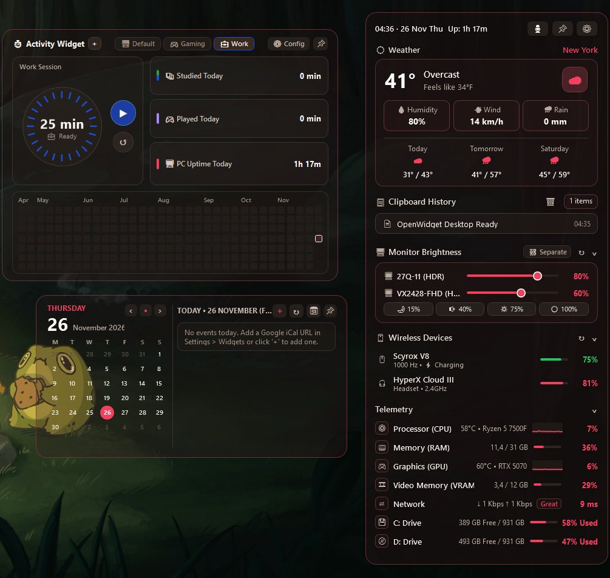

<div align="center">

# OpenWidget for Windows

**Lightweight, native frosted-glass desktop companion for Windows 10 & 11 — single ~448 KB `.exe`, zero dependencies, 0.0% idle CPU.**

[-0078D6?style=for-the-badge&logo=windows)](https://github.com/safeapricot/openwidget-windows)
[](https://github.com/safeapricot/openwidget-windows)
[](https://github.com/safeapricot/openwidget-windows)
[](https://github.com/safeapricot/openwidget-windows)
[](https://github.com/safeapricot/openwidget-windows)

<br />

[](https://github.com/safeapricot/openwidget-windows/releases/download/v3.1/OpenWidget-v3.1.zip)

*Download the `.zip`, extract anywhere, and run **`OpenWidget.exe`**.*

<br />



</div>

---

## Featured: Live Wireless Battery Right on Your Taskbar

<div align="center">
  
</div>

See real-time battery percentages for your **wireless mouse, headset, keyboard, and gamepad** directly on the **Windows Taskbar** — without opening bloated vendor apps like G HUB, Synapse, iCUE, or GG Engine.

- **Clean Status Colors:** **Green** while charging, **Red** at `≤ 10%` with an optional Windows low-battery alert.
- **Smart Behavior:** Automatically hides during fullscreen games/videos and reappears on desktop.
- **Broad Native Support:** **Logitech** (HID++ 2.0/1.0, LIGHTSPEED, Bolt, Unifying, G Headsets), **Razer** (HyperSpeed & BlackShark), **Corsair** (Bragi, Slipstream, Void/HS70/HS80), **SteelSeries** (Arctis & Nova), **HyperX**, **ATK / VXE / Scyrox / CompX** (with Polling Rate `125–8000 Hz` & voltage), **Bluetooth / BLE**, **Generic HID**, and **XInput/DirectInput**.
- **Toggle Anytime:** Enable in **Settings → Widgets → Taskbar Device Batteries** or via the System Tray menu.

---

## Core Features

- **Main Desktop Sidebar:**
  - **Weather:** Live temperature, feels-like, humidity, wind, rain & 3-day forecast (`°C` / `°F`, auto-GPS or manual city, no API key needed).
  - **Monitor Brightness:** Auto-detects all displays — supports **Windows HDR SDR White Level** (bypassing firmware brightness locks) + **DDC/CI**, `Linked / Separate` sync, mouse-wheel `±5%` control, and quick presets (`15%`, `40%`, `75%`, `100%`).
  - **Wireless Devices:** Live battery levels, charging state & polling rate (`Hz`), hidden automatically when no wireless device is connected.
  - **Hardware Telemetry:** Auto-detected **CPU** (model, temp, load & sparkline), **RAM**, **NVIDIA GPU & VRAM** (`nvml.dll` C-API), **Network & Ping**, and **Disks** — show/hide or drag-and-drop reorder any section.
  - **Clipboard & Mic Mute:** Zero-polling clipboard history (`WM_CLIPBOARDUPDATE`) and instant **one-click System Tray / `Ctrl + Shift + M`** microphone mute.
- **Activity Widget** *(Companion Window — enable in Settings → Widgets)*:
  - **4 Modes:** **Default** (Stopwatch), **Gaming** (automatic game detection), **Study** (Pomodoro), and **Work** (click Study pill a second time to switch to Work Mode).
  - **Yearly Heatmap & Breakdown:** 10h proportional day squares with distinct Study / Work / Gaming bands + 8h PC uptime background, Detailed Day View per game, **`[+]` manual time entry**, and **`[+]` Daily Journal** notes with power-loss-safe `.dat` + `.bak` storage.
- **Calendar Widget** *(Companion Window — enable in Settings → Widgets)*:
  - Mini monthly calendar + daily agenda with Google Calendar / private `.ics` feed sync and quick event creation.
- **Native Polish:** Interactive 2D spectrum accent picker, opacity slider (`30%–100%`), `Win + D` (Show Desktop) immunity, Per-Monitor DPI crispness, and a quick first-run **Setup Wizard** (`EN / TR`).

### Quick Start

1. Download **`OpenWidget-v3.1.zip`** from the button above and extract it to a folder.
2. Run **`OpenWidget.exe`**, pick your language (`EN`/`TR`), location, and optional companion widgets in the Setup Wizard.

<details>
<summary><b>Build from Source (No Visual Studio required)</b></summary>

```powershell
& "C:\Windows\Microsoft.NET\Framework64\v4.0.30319\csc.exe" /nologo /target:winexe /optimize+ /platform:x64 /win32icon:app.ico /lib:"C:\Windows\Microsoft.NET\Framework64\v4.0.30319\WPF" /r:PresentationCore.dll /r:PresentationFramework.dll /r:WindowsBase.dll /r:System.Xaml.dll /r:System.Drawing.dll /r:System.Windows.Forms.dll /r:System.Management.dll /r:System.Device.dll /out:OpenWidget.exe OpenWidget.cs
```

</details>

---

## 🇹🇷 Kısa Türkçe Özet

**OpenWidget**, Windows 10/11 için tek bir **~448 KB `.exe`** dosyasından oluşan, sıfır kurulumlu ve **`%0.0` boşta CPU** tüketen yerel masaüstü widget'ıdır.

- **Görev Çubuğunda Kablosuz Pil Göstergesi:** Kablosuz fare, kulaklık, klavye ve kumanda şarj yüzdelerini ekstra sürücü yazılımı olmadan doğrudan Windows taskbar'ında gösterir (**şarjda yeşil**, **`≤ %10` kırmızı + isteğe bağlı düşük pil bildirimi**; tam ekranda otomatik gizlenir). **Ayarlar → Ek Widget'lar** kısmından tek tıkla açabilirsiniz.
- **Ana Widget:** Canlı **Hava Durumu**, **Monitör Parlaklığı**, **Kablosuz Cihazlar**, **Donanım Telemetrisi** (CPU/RAM/GPU/VRAM/Ağ & Ping/Diskler), **Pano Geçmişi** ve **Sistem Tepsisi / `Ctrl + Shift + M`** tek tık mikrofon susturma; tüm modüller **sürükle-bırak** ile sıralanabilir.
- **Aktivite & Takvim Widget'ları** *(Ek Widget'lardan isteğe bağlı açılır)*:
  - **Aktivite Widgeti:** `Default`, otomatik oyun algılayan **Eğlence**, **Ders** (Pomodoro) ve **İş Modu** (Ders butonuna 2. tıkta açılır), başlıkta **`[+]` Günlük notu ekleme**, günlere detaylı oyun/not bakışı, manuel süre ekleme ve yıllık ısı haritası.
  - **Takvim Widget'ı:** Mini aylık takvim, günlük ajanda ve Google Takvim (`.ics`) senkronizasyonu.
- **Kurulum:** [OpenWidget-v3.1.zip](https://github.com/safeapricot/openwidget-windows/releases/download/v3.1/OpenWidget-v3.1.zip) dosyasını indirip klasöre çıkarın ve `OpenWidget.exe`'yi çalıştırın.

---

## License

MIT License — Created by [@safeapricot](https://github.com/safeapricot).
